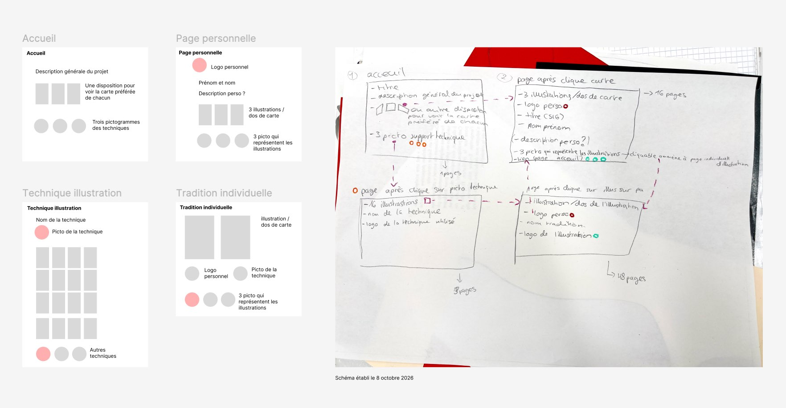

# Switzerland is Great : Traditions vivantes suisses

Un projet qui s'inscrit dans la thématique des Portes Ouvertes 2026. Lancé dans les cours de A. Hogge Duc / C. Buclin / D. d'Agostino.

## Concept

Pour présenter sur le web le travail d'illustration réalisé, un site web est élaboré collectivement pour réaliser ce travail.

Outil utilisé: [Framer](https://framer.com/)

## Planning

- **29 octobre:** chaque élève fait une proposition d'un design pour l'une des quatre pages. Familiarisation avec Framer.
- **5 novembre:** on évalue les propositions, on choisit la direction artistique. Attribution des pages à réaliser (page perso, les trois cartes).
- **12 novembre:** finalisation des pages.

## Tâches pour le jeudi 29 octobre

- Faire le design de la page qui vous a été attribuée - [voir document](https://eduvaud.sharepoint.com/:x:/r/sites/ERACOM_2627_GR450_Teams/Documents%20partages/Graphisme%20Projets%20(WEB)/T%C3%A2ches%2029%20octobre.xlsx?d=w151c58c0a1d64fdf9ef970895aefb0d8&csf=1&web=1&e=sgyaVi) et votre nom dans la liste ci-dessous.
- Vous familiariser avec *Framer*, p.ex. en suivant un tutoriel vidéo.

## Principe des pages

Le site comporte quatre modèles de pages. Pour chaque modèle, quatre élèves vont faire une proposition. 
Cela nous permettra de choisir, le 5 novembre, un design pour l'ensemble du projet, et une mise en page pour chacune des pages.

- **Page d'accueil.** (Néomie, Angelle, Louane, Lou)  
Comporte: 
  - un titre
  - une description du projet
  - une sélection d'images de cartes (p.ex. un carousel)
  - trois pictogrammes qui montrent les techniques.
- **Page d'une technique d'illustration.** (Morgane, Noah, Bruna, Ulysse)  
Comporte:
  - Nom de la technique.
  - Les 16 illustrations (liens).
  - Pictogramme de la technique.
- **Page d'auteur** (Clara, Jules, Elie, Daniel)
  - Trois illustrations/Dos de carte.
  - Pictogramme personnel.
  - Nom, prénom.
  - (Description perso?)
  - Trois pictogrammes qui représentent les illustrations (liens). 
- **Page d'une tradition individuelle.** (Cirisella, Arina, Lorie, Manuella)
  - Illustration / dos de l'illustration. 
  - Pictogramme personnel (lien)
  - Nom de la tradition.
  - Description courte de la tradition.
  - Logo de l'llustration.
  

Voir [le schéma explicatif](https://www.figma.com/design/xQJgXdzGKq8asYA5rrhyg4/Wireframe?node-id=0-1&t=hvb8vRTpYr77E7DU-1) dans Figma

Pictogrammes à créer pour chaque élève (cours de Mme C. Buclin):
- Un pictogramme personnel qui vous représente. Libre, graphique, symbolique (pas un portrait).
- Un picto pour chacune de vos trois illustrations. Une version simplifiée, schématique, abstraite.
- Une proposition de picto pour l'une des techniques d'illustration. Travailler en coordination, pour former une série cohérente de trois pictogrammes.
- Si on a du temps, pourquoi pas créer aussi des pictogrammes de cantons?

Technique pictogrammes: 

- Format vectoriel (sera exporté pour le web en SVG).
- Doit rester lisible à une taille d'environ 50x50 pixels.
- Couleurs: pas plus de deux couleurs dominantes.

## Infos techniques

Précisions pour la réalisation des modèles de page, le 29 octobre. 

#### Choix de l'outil

- La proposition est de créer votre modèle de page dans Framer (qui est assez similaire à Figma). 
- Si vous trouvez trop compliqué d'utiliser un nouveau logiciel, vous pouvez les faire dans Figma.

#### Largeur de page dans Framer

Utiliser **1440px** pour l'écran ordinateur/desktop. C'est plus grand que le par defaut de framer qui est 1200px. La raison: les sites seront montrés aux portes ouvertes sur écran iMac.

Utiliser **390** (valeur par défaut de Framer) pour l'écran mobile.

#### Fontes typographiques

Comme pour les portfolios, il faut se restreindre aux typos *Open-Source*, car l'objectif est de mettre le site en ligne. La plupart des fontes de la typothèque ne permettent pas cela.

Possibilités: 

1. **Une seule typo:** une seule police de caractères pour tout le site. Jouer avec les graisses, tailles, majuscules etc pour assurer une hiérarchie.
2. **Deux typos complémentaires:** Une police pour la navigation et les titres; une deuxième police pour le corps de texte, les descriptions.

Voir le document [Choix de typo Google](https://www.figma.com/design/bSEZ7pe58f1VN6MfkS1l3Q/Choix-de-Typo-Google?m=auto&t=t5wrNFUyVc7aeXYT-6) pour des suggestions.

***